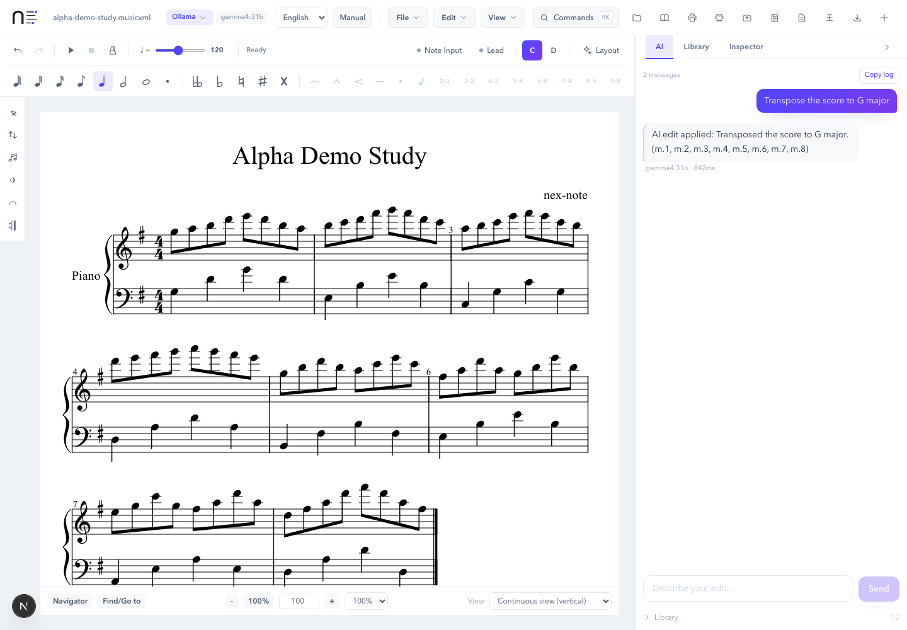

# nex-note

<p align="center">
  
</p>

> AGPL community branch: a downloadable music app for private scores, tabs, AI editing, and embeds.

nex-note helps musicians, teachers, choir directors, arrangers, bands, and small music schools work with private score and tab archives in an app-first workflow. The core product loop is: import files the user is allowed to process, render them reliably, ask the AI assistant for cleanup or arrangement changes, preview before applying, validate the result, export practice/exchange files, and embed selected scores privately for students, members, or collaborators.

This is not a replacement for MuseScore, Dorico, Sibelius, Flat, or GuitarPro. It is also not a promise of perfect PDF/photo conversion. PDF and image workflows are assisted import paths that require review and correction.

## Status

- Current version: `0.0.7`.
- Release channel: private AGPL relaunch / teacher-MVP preview.
- Founder build available on request for macOS app testing.
- Primary development branch: `devel`.
- Published alpha snapshots previously lived on `main`; older MIT copies remain under their original license.
- Current focus: app packaging, private archive workflow, AI-assisted editor actions, real score fixtures, MuseScore round-tripping, private embeds, practice-pack export, and first paid users.
- Release validation on 2026-07-23: `npm test` passed with `991` tests, coverage gates and the Next 16.2.11 production build passed, and all `30` browser smoke tests passed. The production dependency audit reports `0` vulnerabilities. The bounded MuseScore roundtrip completed with `passed-with-local-musescore-limit`; MuseScore 4.7.3 remained crash-unstable across source and nex-note conversions, so crash-only differences remain inconclusive.

Expect rough edges around desktop packaging, provider setup, external conversion tools, advanced engraving parity, and model-dependent AI quality.

## License And Use Boundaries

Current source code is licensed under `AGPL-3.0-or-later`; see [LICENSE](./LICENSE), [NOTICE](./NOTICE), and [TRADEMARKS.md](./TRADEMARKS.md).

Use nex-note only with scores you created, own, are licensed to process, or that are in the public domain. Do not use nex-note to copy, convert, distribute, or commercialize copyrighted scores without permission.

## Why It Exists

Notation editors are strong at engraving, but archive and publishing workflows are still fragmented: open mixed score formats in an app, repair an imported file, ask for arrangement help, extract student parts, transpose for instruments, create a MIDI practice track, embed a private score for members, and confirm that the result still opens in MuseScore. nex-note focuses on those companion workflows instead of trying to become a full notation suite.

The core value is:

- **Semantic edits instead of raw XML patching** for supported operations.
- **Preview-before-apply AI workflows** for cleanup, arrangement, practice, and export-prep changes.
- **Local-first file handling** for scores and conversion tools.
- **App-first private archive and embed orientation** for members, students, collaborators, and small schools.
- **MuseScore round-trip orientation** through `.mxl`, MusicXML, MIDI, ABC, and project files.

## Screenshot



## Main Capabilities

- Import `.musicxml`, `.xml`, `.mxl`, `.mscz`, GuitarPro files, MIDI, and `.nxn` project files. PDF/photo import is assisted and review-based.
- Render MusicXML in-browser with OpenSheetMusicDisplay.
- Edit notes directly with MuseScore-style keyboard, mouse, QWERTY piano, and live MIDI step-input workflows, including nearest-octave A-G entry, one-shot standard accidentals with measure carry, selection-wide `J` enharmonic respelling, chords, tied-note/chord creation, voices, rests, and atomic undo/redo.
- Insert zero-time grace-note entities before selected anchors—including at irregular-meter barlines—without converting or displacing the main note; paired notation/TAB and MusicXML roundtrip stay synchronized.
- Divide one selected note, chord, or rest into an exact 2:3 through 9:8 tuplet with editable rest units, identity-preserving anchors, automatic integer-division rescaling, paired notation/TAB, and explicit rejection of unsafe ranges or tied/nested sources.
- Use selection ranges, transpose tools, dynamics, articulations with placement controls, ties/slurs with placement controls, repeats, endings, lyrics, text, part metadata, and cascading staff/collision layout controls.
- Use an AI assistant with OpenAI, Ollama, Claude, Gemini, or benchmark mode.
- Preview and confirm risky AI edits before applying them.
- Run validator-guided repair when AI output introduces notation diagnostics.
- Save local `.nxn` project working copies and reopen recent/library scores.
- Boot embeddable score views for private websites or member areas.
- Export `.mxl`, `.abc`, MIDI-backed playback output, and practice-pack JSON.
- Package the local app as a macOS Electron shell.

## First Paid Workflow

Bring your private score/tab archive into nex-note. Use AI-assisted edit/arrange with preview-before-apply. Validate and export MusicXML/MXL/MIDI, with MSCZ checks handled through local MuseScore CLI diagnostics. Publish private embeds for students, members, or collaborators.

Founder testing is focused on this loop rather than a hosted SaaS workflow. The public test website explains the app, collects founder build requests, and exposes `/nex-note-app` as a web alpha preview only.

## Alpha Limits

- AI output quality depends heavily on the selected provider and model.
- PDF and image import depend on Audiveris and local conversion scripts.
- MSCZ, GuitarPro, MIDI, and best-effort ABC workflows depend on MuseScore CLI.
- Some imported MusicXML still uses compatibility fallback when unsupported round-trip tags are present.
- Some notation marks are preserved or rendered but not fully editable yet.
- Courtesy/cautionary accidental intent and none/round/square enclosure are editable from the left Accidentals palette and Inspector without changing pitch. They roundtrip as MusicXML `cautionary`, `parentheses`, and `bracket`, survive Copy/Paste and atomic Undo/Redo, and mirror to paired notation/TAB. Automatic courtesy detection and separate concert/transposed-pitch respelling views remain open.
- MuseScore CLI round-trip validation now captures MusicXML, app-style MXL, and MSCZ diagnostics under `.nex/musescore-roundtrip-smoke-*`; the current local MuseScore 4.7.3 install can SIGABRT even on source fixtures, so native MSCZ parity remains an accepted alpha limit unless a clean external MuseScore run confirms it.
- macOS desktop builds are currently ad-hoc signed; notarization and signing identity selection are still open.
- Local debug/developer routes must be removed, gated, or explicitly documented before distributing polished binaries.

## Quick Start

### Requirements

- Node.js `20.9+`
- npm
- Optional: local Ollama or provider keys for AI editing
- Optional: MuseScore 4 CLI for MSCZ, GuitarPro, MIDI, ABC, and practice-pack workflows
- Optional: Audiveris for PDF/image import
- Optional: a Web MIDI-compatible keyboard or controller for live step-time note and chord entry

Maintainer defaults currently assume macOS paths:

- MuseScore CLI: `/Applications/MuseScore 4.app/Contents/MacOS/mscore`
- Audiveris/PDF conversion: configured through `PDF_TO_MUSESCORE_SCRIPT`

### Install

```bash
git clone https://github.com/hybridpicker/nex-note.git
cd nex-note
```

Stay on `main` to inspect the latest published alpha snapshot. For active development, switch to `devel` first:

```bash
git switch devel
```

Then install dependencies and create a local env file:

```bash
npm install
cp .env.local.example .env.local
```

Run the web app:

```bash
npm run dev
```

The browser opens at `http://localhost:3000`. For a non-auto-opening server:

```bash
npm run dev -- --no-open
```

## Configuration

Copy `.env.local.example` to `.env.local` and fill only the providers you use.

| Variable | Purpose |
| --- | --- |
| `OLLAMA_API_KEY` | Optional Ollama Cloud key; leave empty for local Ollama at `http://localhost:11434`. |
| `OPENAI_API_KEY` | OpenAI API key, consumed only by the server-side provider adapter. |
| `OPENAI_MODEL` | Optional server-side OpenAI model override; defaults to `gpt-5.6-sol`. |
| `ANTHROPIC_API_KEY` | Claude provider key. |
| `CLAUDE_MODEL` | Claude model override. |
| `GEMINI_API_KEY` | Gemini provider key. |
| `PDF_TO_MUSESCORE_SCRIPT` | Custom PDF-to-MuseScore conversion script path. |
| `MUSESCORE_CLI` | Custom MuseScore CLI path. |
| `NEXT_PUBLIC_NEX_NOTE_EMBED_DATA_ENDPOINT` | Optional same-origin embed data endpoint. Supports `{entry}` or `{entryId}` placeholders. |
| `NEX_NOTE_ENABLE_LOCAL_AGENT` | Set to `true` to enable the localhost-only semantic agent interface. |
| `NEX_NOTE_AGENT_SECRET` | Long per-session bearer secret required by the local agent interface. |

Restart the dev server after editing `.env.local`; Next.js reads env vars at startup.

The app opening screen includes an AI readiness panel. It checks local Ollama model discovery, shows whether Claude or Gemini keys are saved in local AI settings, and keeps local helper workflows visible even when no provider is connected.

OpenAI uses the official JavaScript/TypeScript SDK and Responses API. The model is configurable in AI settings, including custom model IDs; `OPENAI_MODEL` is an optional server-side override. The current instruction, compact score/selection context, and recent assistant context are sent to the provider. Output is still untrusted: nex-note repairs and validates it as `ScoreCommand` data and preserves its normal preview, confirmation, validator, semantic-execution, and undo workflow. OpenAI has no raw MusicXML mutation route.

## Local Codex/Agent Interface

The current foundation is an authenticated localhost HTTP tool service at `/api/local-agent`; it is not yet a production-ready MCP server. Enable it locally with `NEX_NOTE_ENABLE_LOCAL_AGENT=true` and a long random `NEX_NOTE_AGENT_SECRET`.

Calls use `Authorization: Bearer <secret>` and JSON containing `tool`, the live `scoreKey`, and tool `arguments`. Tools are `get_score_summary`, `get_selection`, `validate_score`, `plan_score_commands`, `preview_score_commands`, `apply_score_preview`, `discard_score_preview`, and `export_score`.

The interface is disabled unless explicitly enabled, accepts only localhost hostnames, uses five-minute one-use preview IDs, rejects stale revisions, and permits exports only to `.nex/agent-exports` with safe basenames. It exposes no shell, URL fetch, arbitrary read/write, XML patch, or unrestricted path tool. Workflow: inspect score → inspect selection → plan → preview → user confirms → apply → validate → export.

Known limitation: agent apply currently updates the server-side live score session and its server undo availability, but does not push that update into an already-open browser tab's React undo stack. MCP transport and browser/desktop event synchronization remain follow-up work.

## Iframe Embedding

nex-note can boot directly inside a host iframe and fetch score data from the same browser origin:

```html
<iframe src="/nex-note-app/?embed=1&entry=score-123"></iframe>
```

The embed data endpoint must return JSON:

```json
{ "success": true, "xml": "<score-partwise ...", "filename": "score.musicxml" }
```

By default, nex-note requests `/api/nex-note/score-data?entry=<entry>`. Hosts can override this per iframe:

```html
<iframe src="/nex-note-app/?embed=1&entry=score-123&scoreDataUrl=/api/scores/{entry}/nex-note-data"></iframe>
```

For score-only embeds, add `chrome=0`:

```html
<iframe src="/nex-note-app/?embed=1&chrome=0&entry=score-123&scoreDataUrl=/api/scores/{entry}/nex-note-data"></iframe>
```

`chrome=0` hides the full nex-note app chrome and renders only the score. During embed startup, nex-note shows a minimal loading bar instead of the normal app index or welcome UI.

Supported endpoint query parameters are `scoreDataUrl`, `scoreDataEndpoint`, `dataUrl`, `dataEndpoint`, and `endpoint`. The legacy `jarvisEmbed=1&entry=<entry>` URL remains supported and uses `/api/guitar-mentor/knowledge/<entry>/nex-note-data/`.

Embed startup loads MusicXML into the editor first. Playback and `/api/midi` generation are not required for initial rendering.

## macOS Desktop App

Development shell:

```bash
npm run electron:dev
```

Build, verify, and open the local macOS app from the current `devel` worktree:

```bash
npm run app
```

This is the normal packaged-app test workflow. It runs the test suite, creates a production Next.js build, refreshes only the `.app` bundle at `dist/macos/mac-arm64/Nex Note.app`, verifies that the embedded source fingerprint matches the current local worktree, and opens that exact bundle. Committed, staged, unstaged, and untracked local source changes are included. If the source changes while the tests or build are running, the refresh fails instead of stamping a mixed build as current.

Opening the repo-local `.app` from Finder performs the same fingerprint check before the product window opens. A stale or legacy bundle shows a refresh window, runs the guarded local workflow, and restarts into the verified build. The refresh log is stored at `.nex/electron-local-refresh.log`.

The packaged app starts its embedded Next.js server as an Electron utility process. On macOS this server remains part of Nex Note and must not appear as a second generic `exec` application or Dock item. The development command `npm run electron:dev` remains attached to its launching terminal so that development logs stay visible.

For a refresh without opening the app:

```bash
npm run electron:refresh
```

`npm run electron:latest` remains available when you explicitly want to fetch and fast-forward to the latest pushed `origin/devel` before running the local refresh. It requires a clean worktree. Use `npm run electron:build` only for release-oriented DMG and ZIP artifacts.

### Packaged Launch Guardrails

The Electron startup path is intentionally split between the thin entrypoint at `electron/main.cjs` and testable launch helpers in `electron/launch-helpers.cjs`.

Those helpers own:

- Finder-safe child process `PATH` construction for `git`, `npm`, and the Next dev server.
- executable resolution before spawning updater commands.
- local source fingerprint comparison before packaged startup.

`electron/main.cjs` owns the packaged server lifecycle. It uses `utilityProcess.fork`, forwards server output into the Electron log, restarts the server after an unexpected exit, and terminates it when the app quits. Do not replace this with a second `process.execPath` launch in Node mode: macOS may register that executable as a separate generic `exec` application.

Local `devel` is the authority for the repo-local app; startup never fetches or merges a remote branch. The fingerprint includes `HEAD`, tracked changes, untracked files, and local environment files without storing environment-file contents in the bundle. If automated refresh fails, Nex Note reports the log path and opens the last packaged build so a test or compiler failure does not make the app unusable.

Do not move these rules back into untested inline startup code. Update `test/electron-launch-helpers.test.ts` when changing packaged launch, server lifecycle, updater, or macOS PATH behavior.

Current desktop status: useful for local testing and founder alpha builds, not yet a polished signed/notarized distribution. The current package configuration builds macOS `dmg` and `zip` artifacts with `identity: null`, so the output is unsigned/ad-hoc unless a signing identity and notarization workflow are added.

## Multi-app Development

Shared Nex Note work must keep the web core, Electron macOS app, native iPad
app, and the planned Xcode macOS app aligned. Start programming tasks with:

```bash
npm run apps:plan
```

The command examines the current worktree and reports the affected app surfaces
and required validation. Shared runtime changes normally require the full test
suite and production build, an Electron refresh when desktop behavior is
affected, iPad synchronization/doctor checks, and a physical-device smoke test
when the paired iPad is available.

See [Multi-app Development Flow](./docs/multi-app-development-flow.md) for the
change matrix, validation levels, AI-secret rules, and handoff checklist.

## Private iPad App

Nex Note includes a native Capacitor iPad shell for private physical-device
testing. It is not a PWA. A normal iPad sync bundles the shared editor into the
native app, so score editing, touch deletion, file import, and playback launch
without the Mac or a LAN connection. Server-backed AI and conversion tools stay
on the Mac and are available in the optional live-development mode.

After installing full Xcode:

```bash
npm install
npm run ipad:doctor
npm run ipad:sync
npm run ipad:open
```

Select the connected iPad, choose the personal signing team, and press Run. The
installed standalone build does not need a terminal to remain open. Use
`npm run ipad:dev` instead when Fast Refresh and Mac-hosted routes are required;
that explicit mode starts the LAN server and opens Xcode. Selected notes and
rests expose a persistent touch-sized **Delete note** action, and playback
activates the native iOS audio session plus a client-side MIDI fallback.

See [Private iPad Testing](./docs/ipad-private-testing.md) for the one-time Xcode,
signing, Developer Mode, local-network, and troubleshooting steps.

Founder build available on request. The request path is intentionally manual until signing, notarization, and compatibility reporting are ready for broader distribution.

Founder build path:

```bash
git switch devel
npm install
npm run app
```

`npm run app` produces the verified `.app` bundle under `dist/macos`. Use `npm run electron:latest` first only when the founder build must be based on the latest pushed remote commit. Use `npm run electron:build` when you also need the macOS archive and disk-image release artifacts.

## Founder Test File Intake

Founder testers should submit only files they are allowed to process:

- scores they own
- scores they created themselves
- scores they are licensed to process
- public-domain scores

Do not submit copyrighted files without permission. For compatibility tracking, use [Founder test file intake](./docs/founder-test-file-intake.md). Private local fixtures can be stored under `private-fixtures/`, which is ignored by Git.

## Branch And Version Workflow

- `devel` is the active development branch for local app work, Electron/macOS packaging, and alpha hardening.
- `main` is the live website/web-alpha deployment branch for `https://nex-note.com`.
- The AlmaLinux server checks `origin/main` every 10 minutes and, when a newer commit exists, pulls, installs dependencies, runs `npm run build`, restarts PM2 process `nex-note-web`, and saves PM2.
- Versions use the `0.0.x` alpha series.
- The first public alpha is `0.0.1`.
- After a finished development cycle is merged from `devel` into `main`, bump to the next patch version, for example `0.0.2`.
- Keep version bumps in `package.json` and `package-lock.json` together.

Typical website deployment flow:

```bash
git switch devel
# work, test, commit
git push origin devel

git switch main
git merge --ff-only devel
git push origin main
git switch devel
```

Pushing `main` updates the website/web alpha after the next server watcher run. macOS app artifacts are still built and distributed separately.

## Testing

Determine the affected application surfaces before selecting checks:

```bash
npm run apps:plan
```

Run the core checks before merging release-sensitive work:

```bash
npm test
npm run smoke:musescore-roundtrip
npm run test:coverage:check
npm run build
```

Use Playwright for browser coverage:

```bash
npm run test:e2e:smoke
npm run test:e2e:regression
```

For desktop artifacts, also run:

```bash
npm run electron:build
```

`npm test` includes `node --check` for `electron/main.cjs` and `electron/launch-helpers.cjs`, plus regression coverage for packaged launch freshness decisions, the invisible utility-process server, and Finder-style macOS `PATH` handling. For macOS app launch changes, also verify a normal `open dist/macos/mac-arm64/Nex\ Note.app` starts one visible Nex Note application, does not register a separate `exec` application, and starts a packaged Next server on `127.0.0.1`.

Current validation snapshot:

- `npm test`: 991 tests passed on 2026-07-23.
- `npm run test:coverage:check`: passed on 2026-07-23 with 85.59% lines, 78.13% branches, and 86.74% functions.
- `npm run build`: passed with Next 16.2.11 on 2026-07-23.
- `npm run test:e2e:smoke`: 30 tests passed on 2026-07-23.
- Bounded `npm run smoke:musescore-roundtrip -- --timeout-ms=15000 --retries=0`: completed with `passed-with-local-musescore-limit` on 2026-07-23; MuseScore 4.7.3 intermittently aborted on source and generated variants, so crash-only results remain inconclusive rather than nex-note export failures.
- `npm audit --omit=dev`: passed with 0 vulnerabilities on 2026-07-23.

## Release Readiness

This repo is suitable for public alpha publication. Before publishing a tagged release or distributing desktop artifacts, verify:

- Unit/integration tests pass.
- Coverage gate passes.
- Production build passes.
- macOS Electron build passes if shipping desktop artifacts.
- Manual smoke covers import, note input, playback, AI preview/apply, `.mxl` export, and a MuseScore round-trip.
- Local-only debug/developer routes are removed, gated, or clearly documented.

Known final-release blockers: notarization, signing identity selection, final icon validation, public binary packaging, and stronger hardening around local debug endpoints.

## Documentation

- [User manual](./docs/user-manual.md)
- [English manual](./docs/user-manual.en.md)
- [Keyboard shortcuts](./docs/keyboard-shortcuts.md)
- [Documentation guide](./docs/README.md)
- [Multi-app development flow](./docs/multi-app-development-flow.md)
- [Private iPad testing](./docs/ipad-private-testing.md)
- [Native macOS Xcode implementation prompt](./docs/macos-xcode-private-testing-prompt.md)
- [Release readiness summary](./docs/final-release-readiness-summary.md)
- [Founder test file intake](./docs/founder-test-file-intake.md)
- [Architecture blueprint](./docs/architecture-blueprint.md)
- [Manual test plan](./docs/user-visible-audible-test-plan.md)
- [Contributing](./CONTRIBUTING.md)

## Security And Privacy

- API keys are read from environment variables and `.env.local`, which is ignored by Git.
- Score conversion runs locally through configured tools.
- No score data is sent to external services unless you configure and use an AI provider.
- Public binary distribution still needs a final review of local debug/developer routes.

## License

The current source code is licensed under `AGPL-3.0-or-later` - see [LICENSE](./LICENSE), [NOTICE](./NOTICE), and [TRADEMARKS.md](./TRADEMARKS.md). Older MIT copies remain under their original license.

The project name "Nex Note", logo, screenshots, and other brand assets are not granted as part of the AGPL code license. Do not use them to imply endorsement or to distribute a confusingly similar product without permission.
