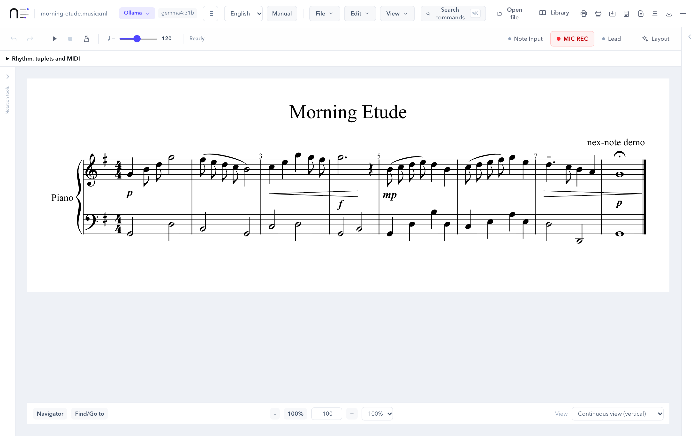
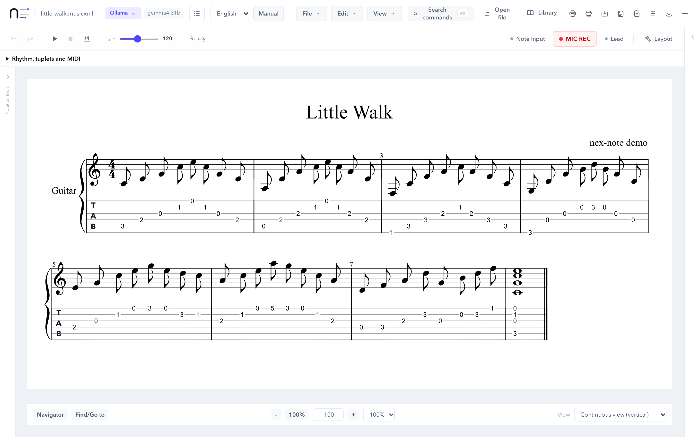
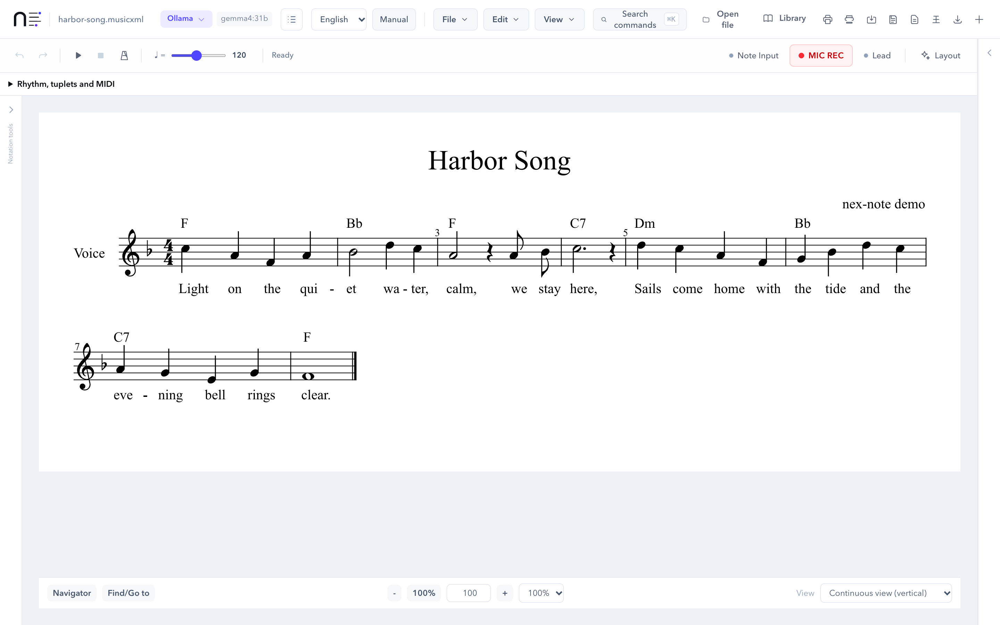
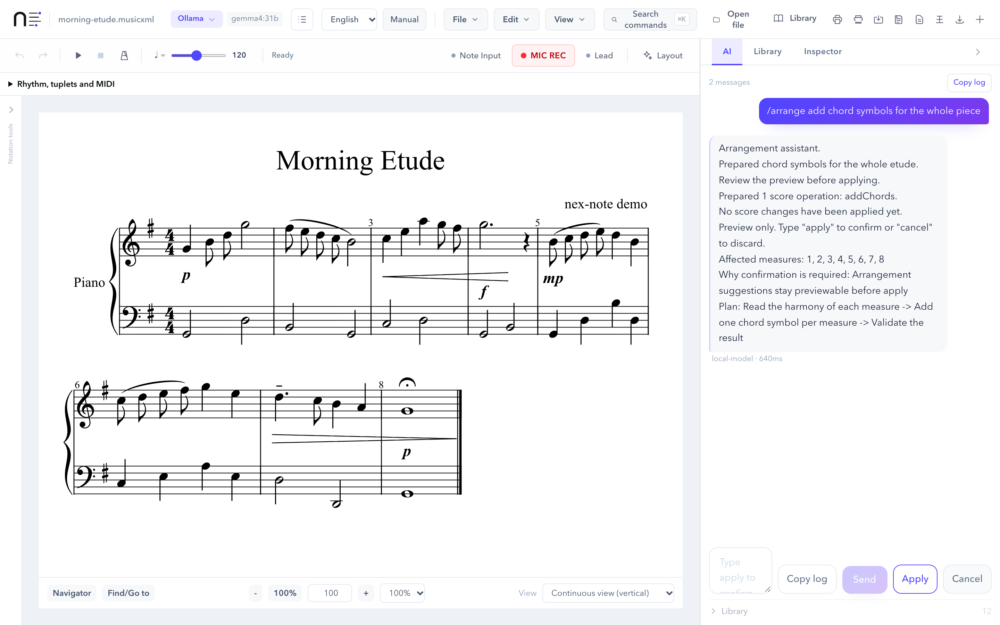
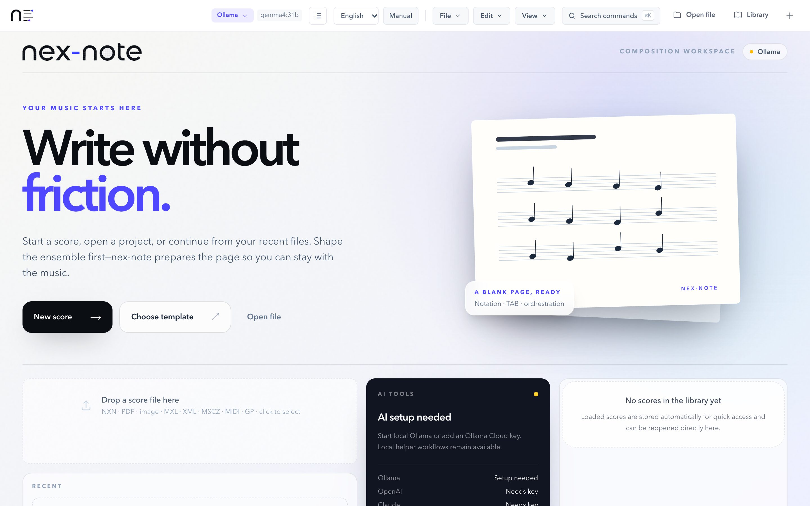

<p align="center">
  
</p>

<p align="center">
  <strong>A local-first music notation app for private scores, guitar tabs, and AI-assisted editing.</strong>
</p>

<p align="center">
  <a href="./LICENSE"></a>
  
  
</p>

<p align="center">
  
</p>

nex-note helps musicians, teachers, choir directors, arrangers, and small music schools work with their own score and tab archives. Import a file, render it, fix and arrange it with keyboard, mouse, MIDI, or an AI assistant, check the result, and export it back to MusicXML, MIDI, or MuseScore.

It does not try to replace MuseScore, Dorico, Sibelius, or Guitar Pro. It focuses on the work around them: cleaning up imports, writing parts, transposing, building practice material, and sharing scores privately.

> **Alpha software.** nex-note is in active development (`0.0.x`). Expect rough edges in desktop packaging, provider setup, external conversion tools, and advanced engraving.

## Screenshots

<table>
  <tr>
    <td width="50%"><br><sub><b>Guitar notation and TAB</b>, kept in sync while you edit either staff.</sub></td>
    <td width="50%"><br><sub><b>Lead sheets</b> with chord symbols and multi-syllable lyrics.</sub></td>
  </tr>
  <tr>
    <td width="50%"><br><sub><b>Preview before apply</b>: AI edits are shown as a plan and applied only after you confirm.</sub></td>
    <td width="50%"><br><sub><b>Start screen</b> with templates, recent files, and AI provider status.</sub></td>
  </tr>
</table>

<sub>All screenshots use original demo scores from <code>e2e/fixtures/readme-*.musicxml</code>. The AI response in the preview screenshot is a mock, so it needs no API key. Regenerate the screenshots with <code>node scripts/capture-readme-screenshots.mjs http://127.0.0.1:3000</code> while the dev server is running.</sub>

## Features

**Notation editing**
- MuseScore-style note input with keyboard, mouse, an on-screen QWERTY piano, or a live MIDI keyboard.
- Chords, ties, multiple voices, rests, grace notes, and tuplets from 2:3 to 9:8.
- Dynamics, hairpins, articulations, slurs, repeats, endings, lyrics, chord symbols, and text.
- Courtesy accidentals, enharmonic respelling, transposition, and atomic undo/redo.
- Guitar notation and TAB staves stay synchronized.

**AI assistant**
- Works with OpenAI, Claude, Gemini, or a local Ollama model.
- The AI suggests semantic score operations, not raw XML patches.
- Larger edits show a plan and wait for your confirmation before they change the score.
- A validator checks the result and can trigger a repair pass when AI output introduces notation errors.

**Import and export**
- Opens `.musicxml`, `.xml`, `.mxl`, `.mscz`/`.mscx`, Guitar Pro, MIDI, Capella, Power Tab, MEI, and `.nxn` project files; PDFs and photos of sheet music are read with Audiveris.
- Exports `.mxl`, MusicXML, MIDI, `.abc`, and practice-pack JSON.
- Checks MuseScore round-trips through the MuseScore CLI.
- Imports PDFs and images with Audiveris. This path always needs review and correction.

**Apps and sharing**
- Runs in the browser, as a macOS Electron app, and as a native iPad app built with Capacitor.
- Embeds scores in private websites or member areas through an iframe ([embed parameters](./docs/embed-parameters.md)).

## Quick start

Requirements: Node.js `20.9+` and npm. The following are optional:

- Ollama or an API key for AI editing.
- MuseScore 4 for MSCZ, Guitar Pro, MIDI, and ABC conversion.
- Audiveris for PDF and image import.
- A Web MIDI keyboard for live note entry.

```bash
git clone https://github.com/hybridpicker/nex-note.git
cd nex-note
npm install
cp .env.local.example .env.local   # add only the provider keys you use
npm run dev
```

The app opens at `http://localhost:3000`. Without any AI provider configured, nex-note still works as a notation editor.

To build and open the macOS desktop app, run `npm run app`. On Linux (Omarchy/Hyprland), run `./linux/install.sh`. For the native iPad app, see [Private iPad testing](./docs/ipad-private-testing.md).

## Privacy

- Scores stay on your machine. Conversion runs locally through the tools you configure.
- Score data goes to an external service only when you configure an AI provider and use it. nex-note then sends the instruction plus a compact summary of the score and selection.
- API keys are read on the server side from `.env.local`, which Git ignores. They never go into the browser or the native app bundles.

## Documentation

- [User manual](./docs/user-manual.en.md) (also in [German](./docs/user-manual.md), [French](./docs/user-manual.fr.md), [Spanish](./docs/user-manual.es.md), and [Chinese](./docs/user-manual.zh.md))
- [Keyboard shortcuts](./docs/keyboard-shortcuts.md)
- [Development guide](./docs/development.md): configuration, local agent interface, embedding, desktop and iPad apps, testing
- [Linux (Omarchy) roadmap](./docs/linux-pro-roadmap.md)
- [Architecture blueprint](./docs/architecture-blueprint.md)
- [Multi-app development flow](./docs/multi-app-development-flow.md)
- [Documentation index](./docs/README.md)

## Contributing

Issues and pull requests are welcome. Read [CONTRIBUTING.md](./CONTRIBUTING.md) first. Active development happens on the `devel` branch, and `main` holds the published snapshot.

Use only scores that you created, own, are licensed to process, or that are in the public domain. Do not attach copyrighted scores to issues or pull requests.

## License

The source code is licensed under [AGPL-3.0-or-later](./LICENSE). See [NOTICE](./NOTICE) for scope notes. Older MIT-licensed copies of the earlier public alpha remain under their original license.

The name "nex-note", the logo, and other brand assets are not covered by the code license. See [TRADEMARKS.md](./TRADEMARKS.md). Forks should use their own name and visual identity.

MuseScore, Dorico, Sibelius, Guitar Pro, and other named products are trademarks of their owners. nex-note is not affiliated with them.
