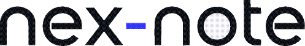

# nex-note

<p align="center">
  
</p>

> AGPL community branch: a downloadable music app for private scores, tabs, AI editing, and embeds.

nex-note helps musicians, teachers, choir directors, arrangers, bands, and small music schools work with private score and tab archives in an app-first workflow. The core product loop is: import files the user is allowed to process, render them reliably, ask the AI assistant for cleanup or arrangement changes, preview before applying, validate the result, export practice/exchange files, and embed selected scores privately for students, members, or collaborators.

This is not a replacement for MuseScore, Dorico, Sibelius, Flat, or GuitarPro. It is also not a promise of perfect PDF/photo conversion. PDF and image workflows are assisted import paths that require review and correction.

## Status

- Current version: `0.0.1`.
- Release channel: private AGPL relaunch / teacher-MVP preview.
- Founder build available on request for macOS app testing.
- Primary development branch: `devel`.
- Published alpha snapshots previously lived on `main`; older MIT copies remain under their original license.
- Current focus: app packaging, private archive workflow, AI-assisted editor actions, real score fixtures, MuseScore round-tripping, private embeds, practice-pack export, and first paid users.
- Recent validation on 2026-05-13: `npm test`, `npm run test:coverage:check`, `npm run build`, and `npm audit --audit-level=high` passed.

Expect rough edges around desktop packaging, provider setup, external conversion tools, advanced engraving parity, and model-dependent AI quality.

## License And Use Boundaries

Current source code is licensed under `AGPL-3.0-or-later`; see [LICENSE](./LICENSE), [NOTICE](./NOTICE), and [TRADEMARKS.md](./TRADEMARKS.md).

Use nex-note only with scores you created, own, are licensed to process, or that are in the public domain. Do not use nex-note to copy, convert, distribute, or commercialize copyrighted scores without permission.

## Why It Exists

Notation editors are strong at engraving, but archive and publishing workflows are still fragmented: open mixed score formats in an app, repair an imported file, ask for arrangement help, extract student parts, transpose for instruments, create a MIDI practice track, embed a private score for members, and confirm that the result still opens in MuseScore. nex-note focuses on those companion workflows instead of trying to become a full notation suite.

The core value is:

- **Semantic edits instead of raw XML patching** for supported operations.
- **Preview-before-apply AI workflows** for cleanup, arrangement, practice, and export-prep changes.
- **Local-first file handling** for scores and conversion tools.
- **App-first private archive and embed orientation** for members, students, collaborators, and small schools.
- **MuseScore round-trip orientation** through `.mxl`, MusicXML, MIDI, ABC, and project files.

## Screenshot


## Main Capabilities

- Import `.musicxml`, `.xml`, `.mxl`, `.mscz`, GuitarPro files, MIDI, and `.nxn` project files. PDF/photo import is assisted and review-based.
- Render MusicXML in-browser with OpenSheetMusicDisplay.
- Edit notes directly with MuseScore-style keyboard and mouse workflows.
- Use selection ranges, transpose tools, dynamics, articulations, ties/slurs, repeats, endings, lyrics, text, part metadata, and layout hints.
- Use an AI assistant with Ollama, Claude, Gemini, or benchmark mode.
- Preview and confirm risky AI edits before applying them.
- Run validator-guided repair when AI output introduces notation diagnostics.
- Save local `.nxn` project working copies and reopen recent/library scores.
- Boot embeddable score views for private websites or member areas.
- Export `.mxl`, `.abc`, MIDI-backed playback output, and practice-pack JSON.
- Package the local app as a macOS Electron shell.

## First Paid Workflow

Bring your private score/tab archive into nex-note. Use AI-assisted edit/arrange with preview-before-apply. Validate and export MusicXML/MXL/MSCZ/MIDI. Publish private embeds for students, members, or collaborators.

Founder testing is focused on this loop rather than a hosted SaaS workflow. The public test website explains the app, collects founder build requests, and exposes `/nex-note-app` as a web alpha preview only.

## Alpha Limits

- AI output quality depends heavily on the selected provider and model.
- PDF and image import depend on Audiveris and local conversion scripts.
- MSCZ, GuitarPro, MIDI, and best-effort ABC workflows depend on MuseScore CLI.
- Some imported MusicXML still uses compatibility fallback when unsupported round-trip tags are present.
- Some notation marks are preserved or rendered but not fully editable yet.
- macOS desktop builds are currently ad-hoc signed; notarization and signing identity selection are still open.
- Local debug/developer routes must be removed, gated, or explicitly documented before distributing polished binaries.

## Quick Start

### Requirements

- Node.js `20.9+`
- npm
- Optional: local Ollama or provider keys for AI editing
- Optional: MuseScore 4 CLI for MSCZ, GuitarPro, MIDI, ABC, and practice-pack workflows
- Optional: Audiveris for PDF/image import

Maintainer defaults currently assume macOS paths:

- MuseScore CLI: `/Applications/MuseScore 4.app/Contents/MacOS/mscore`
- Audiveris/PDF conversion: configured through `PDF_TO_MUSESCORE_SCRIPT`

### Install

```bash
git clone https://github.com/hybridpicker/nex-note.git
cd nex-note
```

Stay on `main` to inspect the latest published alpha snapshot. For active development, switch to `devel` first:

```bash
git switch devel
```

Then install dependencies and create a local env file:

```bash
npm install
cp .env.local.example .env.local
```

Run the web app:

```bash
npm run dev
```

The browser opens at `http://localhost:3000`. For a non-auto-opening server:

```bash
npm run dev -- --no-open
```

## Configuration

Copy `.env.local.example` to `.env.local` and fill only the providers you use.

| Variable | Purpose |
| --- | --- |
| `OLLAMA_API_KEY` | Optional Ollama Cloud key; leave empty for local Ollama at `http://localhost:11434`. |
| `ANTHROPIC_API_KEY` | Claude provider key. |
| `CLAUDE_MODEL` | Claude model override. |
| `GEMINI_API_KEY` | Gemini provider key. |
| `PDF_TO_MUSESCORE_SCRIPT` | Custom PDF-to-MuseScore conversion script path. |
| `MUSESCORE_CLI` | Custom MuseScore CLI path. |
| `NEXT_PUBLIC_NEX_NOTE_EMBED_DATA_ENDPOINT` | Optional same-origin embed data endpoint. Supports `{entry}` or `{entryId}` placeholders. |

Restart the dev server after editing `.env.local`; Next.js reads env vars at startup.

## Iframe Embedding

nex-note can boot directly inside a host iframe and fetch score data from the same browser origin:

```html
<iframe src="/nex-note-app/?embed=1&entry=score-123"></iframe>
```

The embed data endpoint must return JSON:

```json
{ "success": true, "xml": "<score-partwise ...", "filename": "score.musicxml" }
```

By default, nex-note requests `/api/nex-note/score-data?entry=<entry>`. Hosts can override this per iframe:

```html
<iframe src="/nex-note-app/?embed=1&entry=score-123&scoreDataUrl=/api/scores/{entry}/nex-note-data"></iframe>
```

For score-only embeds, add `chrome=0`:

```html
<iframe src="/nex-note-app/?embed=1&chrome=0&entry=score-123&scoreDataUrl=/api/scores/{entry}/nex-note-data"></iframe>
```

`chrome=0` hides the full nex-note app chrome and renders only the score. During embed startup, nex-note shows a minimal loading bar instead of the normal app index or welcome UI.

Supported endpoint query parameters are `scoreDataUrl`, `scoreDataEndpoint`, `dataUrl`, `dataEndpoint`, and `endpoint`. The legacy `jarvisEmbed=1&entry=<entry>` URL remains supported and uses `/api/guitar-mentor/knowledge/<entry>/nex-note-data/`.

Embed startup loads MusicXML into the editor first. Playback and `/api/midi` generation are not required for initial rendering.

## macOS Desktop App

Development shell:

```bash
npm run electron:dev
```

Local macOS package build:

```bash
npm run electron:build
```

The build writes to `dist/macos`, which is ignored by Git. The app bundle is usually:

```bash
open "$PWD/dist/macos/mac-arm64/Nex Note.app"
```

Current desktop status: useful for local testing and founder alpha builds, not yet a polished signed/notarized distribution. The current package configuration builds macOS `dmg` and `zip` artifacts with `identity: null`, so the output is unsigned/ad-hoc unless a signing identity and notarization workflow are added.

Founder build available on request. The request path is intentionally manual until signing, notarization, and compatibility reporting are ready for broader distribution.

Founder build path:

```bash
git switch devel
npm install
npm run electron:build
```

Expected local outputs are under `dist/macos`, including a `.app` bundle and packaged macOS archive/disk image when Electron Builder completes.

## Founder Test File Intake

Founder testers should submit only files they are allowed to process:

- scores they own
- scores they created themselves
- scores they are licensed to process
- public-domain scores

Do not submit copyrighted files without permission. For compatibility tracking, use [Founder test file intake](./docs/founder-test-file-intake.md). Private local fixtures can be stored under `private-fixtures/`, which is ignored by Git.

## Branch And Version Workflow

- `devel` is the active development branch for local app work, Electron/macOS packaging, and alpha hardening.
- `main` is the live website/web-alpha deployment branch for `https://nex-note.com`.
- The AlmaLinux server checks `origin/main` every 10 minutes and, when a newer commit exists, pulls, installs dependencies, runs `npm run build`, restarts PM2 process `nex-note-web`, and saves PM2.
- Versions use the `0.0.x` alpha series.
- The first public alpha is `0.0.1`.
- After a finished development cycle is merged from `devel` into `main`, bump to the next patch version, for example `0.0.2`.
- Keep version bumps in `package.json` and `package-lock.json` together.

Typical website deployment flow:

```bash
git switch devel
# work, test, commit
git push origin devel

git switch main
git merge --ff-only devel
git push origin main
git switch devel
```

Pushing `main` updates the website/web alpha after the next server watcher run. macOS app artifacts are still built and distributed separately.

## Testing

Run the core checks before merging release-sensitive work:

```bash
npm test
npm run test:coverage:check
npm run build
```

Use Playwright for browser coverage:

```bash
npm run test:e2e:smoke
npm run test:e2e:regression
```

For desktop artifacts, also run:

```bash
npm run electron:build
```

Current validation snapshot from 2026-05-13:

- `npm test`: 645 tests passed.
- `npm run test:coverage:check`: 84.96% lines, 76.57% branches, 85.33% functions.
- `npm run build`: passed.
- `npm audit --audit-level=high`: 0 vulnerabilities.

## Release Readiness

This repo is suitable for public alpha publication. Before publishing a tagged release or distributing desktop artifacts, verify:

- Unit/integration tests pass.
- Coverage gate passes.
- Production build passes.
- macOS Electron build passes if shipping desktop artifacts.
- Manual smoke covers import, note input, playback, AI preview/apply, `.mxl` export, and a MuseScore round-trip.
- Local-only debug/developer routes are removed, gated, or clearly documented.

Known final-release blockers: notarization, signing identity selection, final icon validation, public binary packaging, and stronger hardening around local debug endpoints.

## Documentation

- [User manual](./docs/user-manual.md)
- [English manual](./docs/user-manual.en.md)
- [Keyboard shortcuts](./docs/keyboard-shortcuts.md)
- [Documentation guide](./docs/README.md)
- [Release readiness summary](./docs/final-release-readiness-summary.md)
- [Founder test file intake](./docs/founder-test-file-intake.md)
- [Architecture blueprint](./docs/architecture-blueprint.md)
- [Manual test plan](./docs/user-visible-audible-test-plan.md)
- [Contributing](./CONTRIBUTING.md)

## Security And Privacy

- API keys are read from environment variables and `.env.local`, which is ignored by Git.
- Score conversion runs locally through configured tools.
- No score data is sent to external services unless you configure and use an AI provider.
- Public binary distribution still needs a final review of local debug/developer routes.

## License

The current source code is licensed under `AGPL-3.0-or-later` - see [LICENSE](./LICENSE), [NOTICE](./NOTICE), and [TRADEMARKS.md](./TRADEMARKS.md). Older MIT copies remain under their original license.

The project name "Nex Note", logo, screenshots, and other brand assets are not granted as part of the AGPL code license. Do not use them to imply endorsement or to distribute a confusingly similar product without permission.
